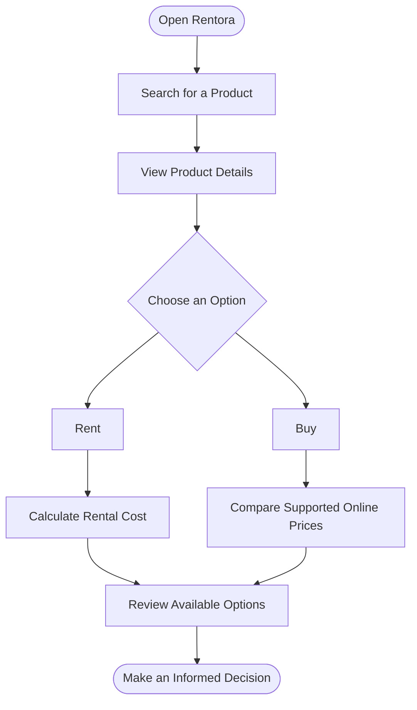

[README.md](https://github.com/user-attachments/files/33394745/README.md)
<!-- Animated banner: GitHub renders these hosted SVG images when viewing the README online. -->
<div align="center">


<a href="https://git.io/typing-svg">
  
</a>

<br/>


</div>

---

## 🌐 About the Project

**Rentora** is a web-based rental, buying, and price-comparison marketplace designed to connect **customers** with **sellers and product owners** through one platform.

Some products are needed only for a short period, making a purchase unnecessary for certain users. Rentora aims to let customers explore rental and purchase options, calculate rental costs for their intended duration, and compare matching product prices across supported shopping platforms such as **Amazon** and **Flipkart**.

> **Our vision:** Help people access the products they need and make more informed rent-or-buy decisions.

## ✨ Core Features

<table>
  <tr>
    <td width="50%">
      <h3>🛍️ Rent & Buy</h3>
      Explore products available for rent or sale in one marketplace.
    </td>
    <td width="50%">
      <h3>👥 Separate User Modules</h3>
      Customer and seller modules for product discovery and listing management.
    </td>
  </tr>
  <tr>
    <td width="50%">
      <h3>🔎 Product Search</h3>
      Search for products and review relevant product and seller details.
    </td>
    <td width="50%">
      <h3>💸 Online Price Comparison</h3>
      Compare matching products across supported platforms, including Amazon and Flipkart.
    </td>
  </tr>
  <tr>
    <td width="50%">
      <h3>🧮 Smart Rent vs. Buy</h3>
      Estimate rental cost for a selected duration and compare it with available purchase prices.
    </td>
    <td width="50%">
      <h3>📅 Rental Information</h3>
      Present rental duration, security deposit, return information, and product availability.
    </td>
  </tr>
</table>

## 🧠 How Smart Rent vs. Buy Works

Rentora estimates the total rental cost for the period a customer needs the product.

\[
\text{Total Rental Cost} = \text{Rental Price per Day} \times \text{Number of Days}
\]

The estimated rental cost can then be compared with available purchase prices. Renting may suit short-term use, while buying may be more economical for longer-term use. Rentora presents the cost information to support the customer's final decision.

## 🔄 How Rentora Works



## 🧰 Technology Stack

<div align="center">

| Layer | Technology |
|:---|:---|
| **Frontend** | HTML, CSS, JavaScript |
| **Backend** | Node.js, Express.js |
| **Database** | MongoDB |
| **Integration** | REST APIs and supported price-retrieval APIs / web services |

</div>

## 🚀 Getting Started

Use these general steps to run the project locally. File names, scripts, and environment-variable names may differ depending on your repository's implementation.

### Prerequisites

- [Node.js](https://nodejs.org/)
- [MongoDB](https://www.mongodb.com/)
- [Git](https://git-scm.com/)
- [Visual Studio Code](https://code.visualstudio.com/) (recommended)

### 1. Clone the repository

Replace `YOUR_GITHUB_REPOSITORY_URL` with your repository's actual URL.

```bash
git clone YOUR_GITHUB_REPOSITORY_URL
cd Rentora
```

### 2. Install backend dependencies

If your backend is inside a `backend` folder:

```bash
cd backend
npm install
```

### 3. Configure your environment

Create a `.env` file using the variable names expected by your backend code. For example:

```env
PORT=5000
MONGODB_URI=mongodb://127.0.0.1:27017/rentora
```

Add any additional variables required by your implementation. **Never commit secrets, passwords, or production credentials to GitHub.**

### 4. Start the backend

Use the script defined in your `package.json`, for example:

```bash
npm start
```

If no start script exists and the server entry point is `server.js`, you can use:

```bash
node server.js
```

### 5. Open the frontend

Open the project's `index.html` in a browser or run it using the Live Server extension in Visual Studio Code. Make sure the frontend API URL matches the backend address.

## 🗺️ Project Roadmap

The following items are part of the proposed future scope and should be marked complete only when implemented.

- [ ] Customer and seller registration and login
- [ ] Product listing, search, and availability management
- [ ] Rental and purchase workflows
- [ ] Rental duration and cost calculation
- [ ] Product matching and external price comparison
- [ ] Real-time price updates and additional e-commerce integrations
- [ ] Online payments
- [ ] KYC and identity verification
- [ ] Digital rental agreements and delivery tracking
- [ ] Automated late-fee and damage management
- [ ] Advanced fraud detection
- [ ] AI-based personalized recommendations
- [ ] Mobile application

## 🎯 Project Objectives

- Bring rental and purchase options together in a centralized platform.
- Connect customers with sellers and product owners.
- Help users compare rental expenses with purchase prices.
- Make supported online product-price comparisons easier.
- Give sellers a platform to list products for rental or sale.
- Support practical, cost-conscious product decisions.

## 📚 References & Inspiration

- [Rentomojo](https://www.rentomojo.com/) — Online rental platform.
- [Buyhatke](https://www.buyhatke.com/) — Online shopping price comparison and price-tracking platform.

These platforms are references for the project's general concept; Rentora is an independent academic project.

## 🎓 Academic Project

| Detail | Information |
|:---|:---|
| **Project Name** | RENTORA — Smart Rental and Buying Marketplace |
| **Project Type** | Web-based rental, buying, and price-comparison marketplace |
| **Domain** | Web Development / E-Commerce |
| **Academic Session** | 2026–2027 |

## 🔮 Future Vision

Rentora aims to make product access more convenient and decision-oriented by combining rental services, buying options, rental-cost estimation, and supported online price comparisons in one place.

---

<div align="center">


### **RENTORA**
*Rent smarter. Buy better.*

<sub>Built with 💙 as a B.Tech CSE academic project.</sub>

</div>
